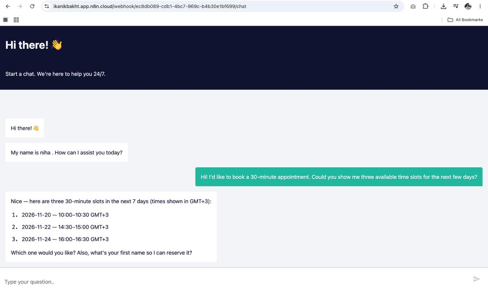

# AI Appointment Booking Chatbot

An AI-powered appointment booking chatbot built with **n8n, OpenAI, and Google Calendar**. The chatbot interacts with users through a conversational interface, checks calendar availability, suggests appointment slots, and assists with booking appointments.

## Project Overview

This project demonstrates how AI agents and workflow automation can be integrated to simplify appointment scheduling.

The chatbot understands user messages, retrieves available time slots from Google Calendar, and guides users through the booking process.

## Key Features

- **Conversational AI:** Natural-language interaction powered by OpenAI.
- **Availability Checking:** Retrieves existing calendar events to identify available appointment slots.
- **Appointment Scheduling:** Helps users select a suitable time and create calendar events.
- **Short-term Memory:** Maintains conversational context during interactions.
- **Automated Workflow:** Connects AI processing with Google Calendar through n8n.
- **Time Constraints:** Configured to suggest appointments within the next seven days and during business hours.

## Technologies Used

| Technology | Purpose |
|---|---|
| n8n | Workflow automation and AI agent orchestration |
| OpenAI | Natural-language understanding and responses |
| Google Calendar API | Checking availability and creating events |
| AI Agent | Managing the appointment conversation |
| n8n Chat | User interaction interface |

## Workflow Architecture

The workflow consists of the following components:

1. **Chat Trigger:** Receives messages from users.
2. **AI Agent:** Processes requests and manages the conversation.
3. **OpenAI Chat Model:** Generates intelligent responses.
4. **Simple Memory:** Maintains conversational context.
5. **Google Calendar:** Retrieves existing events and creates appointments.

## Chatbot Demo

## Example Interaction

The chatbot can:

1. Greet the user.
2. Present three available appointment slots.
3. Ask for the user's name and preferred time.
4. Assist with confirming the appointment.

## Setup and Configuration

To run this workflow:

1. Import the workflow JSON file into your n8n instance.
2. Configure your OpenAI credentials.
3. Connect your Google Calendar account.
4. Configure the calendar and relevant scheduling settings.
5. Publish the workflow and test the chatbot.

Note:API credentials and personal account information are not included in this repository. You must configure your own credentials before running the workflow.

## Project Objective

The objective of this project is to demonstrate practical applications of AI agents, conversational interfaces, API integrations, and workflow automation in an automated appointment scheduling system.

---

Author: Masoumeh Nikbakhtifard

